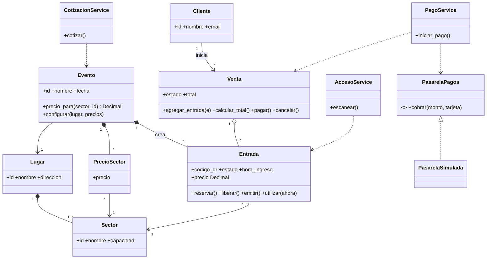
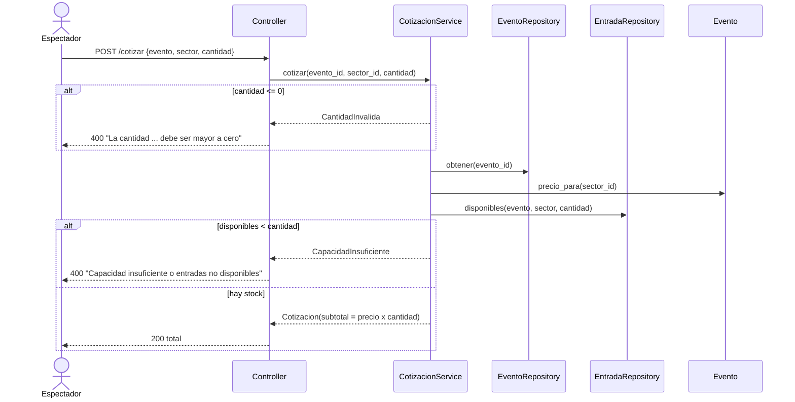
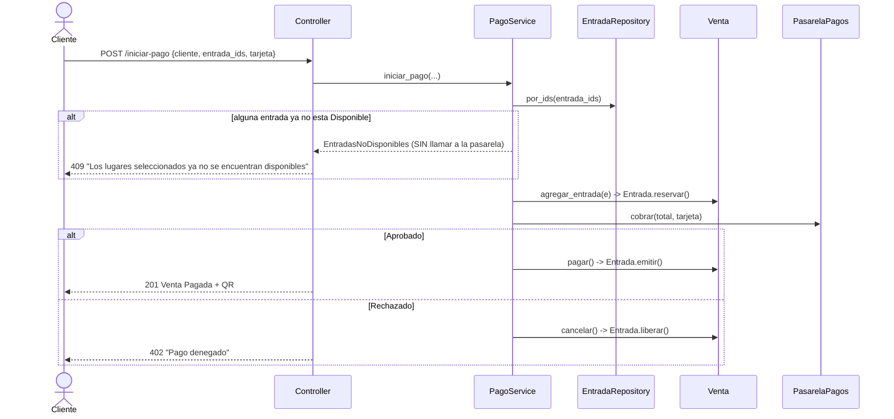
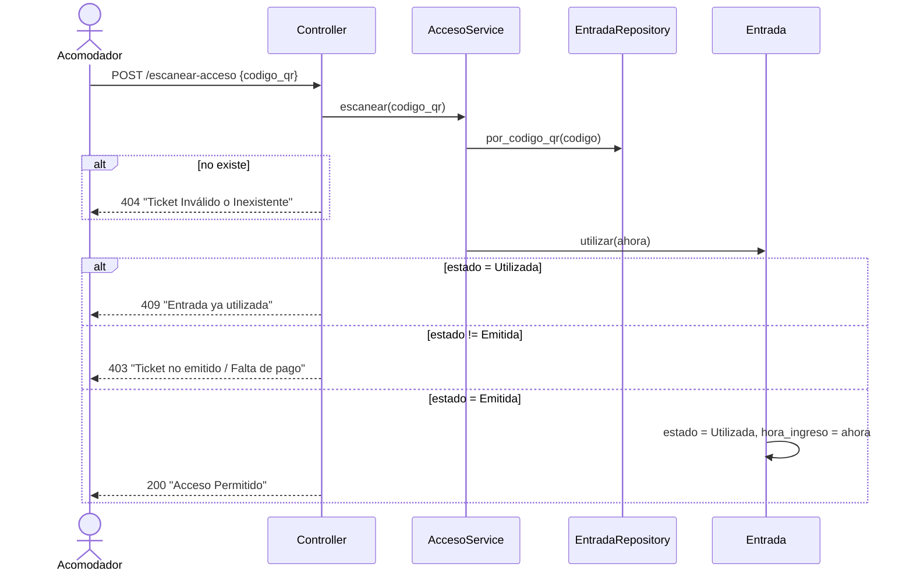

# SmartTicket – TP9 GRASP y SOLID aplicados (Python / FastAPI)

## Ejecutar
```bash
pip install -r requirements.txt
uvicorn app.main:app --reload      # Swagger en http://127.0.0.1:8000/docs
pytest -q                          # 10 escenarios del TP automatizados
```
Orden sugerido en Swagger: `POST /lugares` → `POST /sectores` (x N) → `POST /clientes` → `POST /eventos`
(con un precio por cada sector del lugar; genera las entradas) → `/cotizar` → `/iniciar-pago` → `/escanear-acceso`.
Tarjeta que termina en `0000` = pago rechazado por la pasarela simulada.

## 1. Diagrama de clases (estructura estática)


## 2. Diagramas de secuencia (comportamiento dinámico)

### HU1 – Cotización


### HU2 – Pago y emisión


### HU3 – Control de acceso


## 3. Aplicación de GRASP y SOLID
| Principio | Dónde se aplica |
|---|---|
| **SRP** | Controllers solo traducen HTTP↔servicio; servicios orquestan; repositorios persisten; entidades guardan reglas. |
| **Experto en Información** | `Entrada` valida sus transiciones de estado; `Venta` calcula su total; `Evento` conoce sus precios. Ningún `if` de negocio en controllers. |
| **Creator** | `Evento.configurar()` crea sus `PrecioSector` y sus `Entrada` (las que usa/contiene). |
| **Controller (GRASP)** | Los servicios son los controladores de caso de uso. |
| **Low Coupling / Pure Fabrication** | Repositorios y servicios no existen en el dominio real, se inventan para bajar el acoplamiento. |
| **Protected Variations** | `PasarelaPagos` aísla el cambio de proveedor de pagos. |
| **OCP** | Nueva pasarela = nueva clase, sin modificar `PagoService`. |
| **LSP** | `PasarelaSimulada` sustituye a `PasarelaPagos` (el test usa un espía subclase). |
| **ISP** | Interfaz de pasarela con un solo método; servicios dependen solo de los repositorios que usan. |
| **DIP** | Dependencias inyectadas por constructor (`dependencies.py` es la única composición). |

## 4. Decisiones de diseño a justificar en la defensa
- `/cotizar` devuelve además `entrada_ids` propuestos; `/iniciar-pago` los recibe. Así se puede detectar la pérdida de disponibilidad (HU2-E3).
- El total se **recalcula en el servidor** a partir de las entradas; nunca se confía en el monto del cliente.
- Las entradas se **reservan** (`Reservada`) antes de cobrar y se liberan si la pasarela rechaza.
- Concurrencia: en SQLite alcanza el chequeo+reserva en una transacción; en producción se usaría `SELECT ... FOR UPDATE` o bloqueo optimista (columna `version`).
- Mejoras posibles: validar que el QR corresponda al evento del día; endpoint `webhook-pagos` para pasarelas asíncronas.
